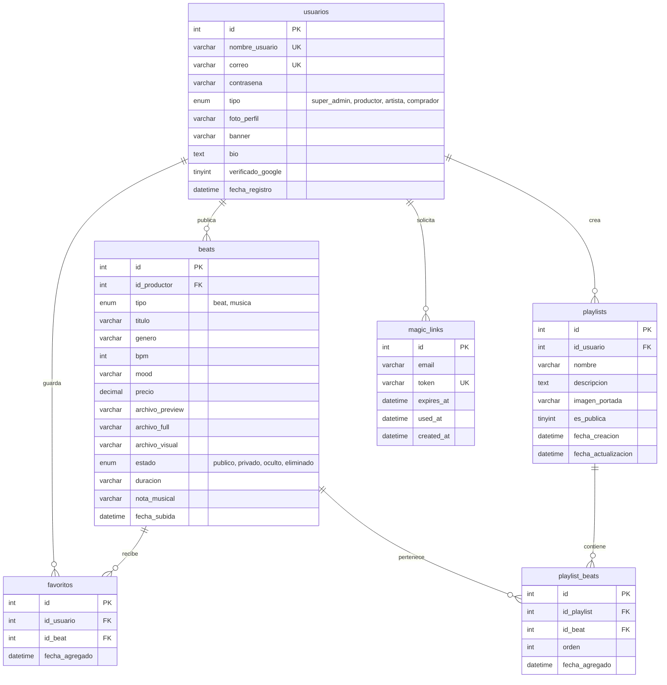

# 🎵 LubaBeats (Chojin) - Especificación y Arquitectura del Sistema

> **Guía Técnica de Reconstrucción y Despliegue en Frameworks Modernos**  
> Este documento contiene la especificación funcional completa, modelo de datos, flujos de negocio, endpoints y arquitectura multimedia de **LubaBeats**, diseñado para servir como plano técnico (*blueprint*) para su migración o reescritura en cualquier framework moderno (como **Laravel 11**, **Next.js 15 / React**, **NestJS**, o **FastAPI / Django**).

---

## 📌 Tabla de Contenidos
1. [Visión General del Proyecto](#1-visión-general-del-proyecto)
2. [Roles de Usuario y Matriz de Permisos](#2-roles-de-usuario-y-matriz-de-permisos)
3. [Modelo de Base de Datos y Diccionario de Datos](#3-modelo-de-base-de-datos-y-diccionario-de-datos)
4. [Módulos Funcionales y Flujos de Negocio](#4-módulos-funcionales-y-flujos-de-negocio)
   - 4.1. [Autenticación y Seguridad](#41-autenticación-y-seguridad)
   - 4.2. [Catálogo Público y Búsqueda](#42-catálogo-público-y-búsqueda)
   - 4.3. [Panel de Productor y Subida de Beats](#43-panel-de-productor-y-subida-de-beats)
   - 4.4. [Panel de Artista](#44-panel-de-artista)
   - 4.5. [Panel de Usuario: Playlists y Favoritos](#45-panel-de-usuario-playlists-y-favoritos)
   - 4.6. [Perfiles Públicos y Compartición](#46-perfiles-públicos-y-compartición)
   - 4.7. [Panel de SuperAdmin y Moderación](#47-panel-de-superadmin-y-moderación)
5. [Arquitectura Multimedia (Integración Cloudinary)](#5-arquitectura-multimedia-integración-cloudinary)
6. [Matriz de Rutas y Endpoints API](#6-matriz-de-rutas-y-endpoints-api)
7. [Fallas Históricas a Corregir en el Nuevo Sistema](#7-fallas-históricas-a-corregir-en-el-nuevo-sistema)
8. [Recomendaciones para el Despliegue y Stack Moderno](#8-recomendaciones-para-el-despliegue-y-stack-moderno)

---

## 1. Visión General del Proyecto

**LubaBeats** es una plataforma web híbrida de **streaming, exhibición y comercialización de instrumentales (beats) y música independiente**. Su objetivo es conectar a productores musicales con artistas, creadores de contenido y oyentes.

### Capacidades Principales
- **Explorador armónico de instrumentales:** Filtros musicales avanzados por **BPM**, **Escala / Tonalidad** (Key musical), **Género** y **Mood** (estado de ánimo).
- **Reproductor de audio en streaming continuo:** Barra de reproducción persistente que permite escuchar previews sin interrumpir la navegación.
- **Almacenamiento Cloud:** Los archivos de audio (`.mp3`, `.wav`) y visuales (`.jpg`, `.png`, loops de video `.mp4`) se sirven a través de un CDN global (**Cloudinary**).
- **Curación y Listas:** Sistema para crear listas de reproducción públicas o privadas con orden personalizado y colecciones de "Me Gusta".
- **Autenticación Híbrida:** Login tradicional con contraseña + **Magic Links** (enlaces de acceso de un solo uso sin contraseña enviados al email) + soporte para Google OAuth.

---

## 2. Roles de Usuario y Matriz de Permisos

El sistema define 4 tipos de cuenta en la columna `tipo` de la tabla `usuarios`:

| Rol (`tipo`) | Descripción | Acceso a Paneles | Acciones Permitidas |
| :--- | :--- | :--- | :--- |
| **`super_admin`** | Administrador de la plataforma | `/admin/*` | Gestión total de usuarios, eliminación o baneo de cuentas, edición/moderación de cualquier beat, métricas globales. |
| **`productor`** | Creador y vendedor de instrumentales | `/productor/*` | Subir beats, definir precios, BPM, escalas, publicar/ocultar beats, ver estadísticas de reproducciones. |
| **`artista`** | Creador musical / Cantante | `/artista/*` | Subir temas/demos de música, gestionar lanzamientos y colaboraciones. |
| **`comprador`** | Oyente / Cliente general | `/usuario/*` | Explorar catálogo, reproducir previews, dar favoritos, crear y ordenar playlists, personalizar perfil. |

---

## 3. Modelo de Base de Datos y Diccionario de Datos

Diagrama entidad-relación del sistema:



### Detalle de Campos por Tabla

#### 1. `usuarios`
- `id` (INT, PK, Auto-increment)
- `nombre_usuario` (VARCHAR 100, UNIQUE, NOT NULL): Identificador público usado en URLs (`/perfil/{nombre_usuario}`).
- `correo` (VARCHAR 255, UNIQUE, NOT NULL): Correo electrónico principal.
- `contrasena` (VARCHAR 255, NULL): Hash seguro (`bcrypt`). Puede ser NULL si el usuario solo usa Google OAuth o Magic Link.
- `tipo` (ENUM): `'super_admin'`, `'productor'`, `'artista'`, `'comprador'`. Default `'comprador'`.
- `foto_perfil` (VARCHAR 255): URL de Cloudinary o ruta local del avatar.
- `banner` (VARCHAR 255): URL de Cloudinary de la imagen de cabecera.
- `bio` (TEXT): Breve descripción biográfica.
- `verificado_google` (TINYINT 1): `1` si validó su identidad mediante OAuth.
- `fecha_registro` (DATETIME): Timestamp de creación.

#### 2. `beats`
- `id` (INT, PK, Auto-increment)
- `id_productor` (INT, FK -> `usuarios.id`, NOT NULL): Creador del beat.
- `tipo` (ENUM): `'beat'` (instrumental) o `'musica'` (tema con voz). Default `'beat'`.
- `titulo` (VARCHAR 200, NOT NULL): Nombre de la pista.
- `genero` (VARCHAR 100): Trap, Boombap, Drill, Lo-Fi, Reggaeton, R&B, etc.
- `bpm` (INT): Tempo musical (ej. 140).
- `mood` (VARCHAR 100): Estado anímico (Oscuro, Triste, Enérgico, Relajado).
- `precio` (DECIMAL 10,2): Precio en USD u otra moneda local. Default `0.00`.
- `archivo_preview` (VARCHAR 255): URL del audio de muestra (con tag vocal o versión streaming).
- `archivo_full` (VARCHAR 255): URL del audio en alta definición (master sin tag para compradores).
- `archivo_visual` (VARCHAR 255): URL de la portada o loop de video MP4.
- `estado` (ENUM): `'publico'`, `'privado'`, `'oculto'`, `'eliminado'`.
- `duracion` (VARCHAR 50): Tiempo de la pista (ej. `"02:45"`).
- `nota_musical` (VARCHAR 50): Tonalidad musical (ej. `"Am"`, `"C# Minor"`, `"F Major"`).
- `fecha_subida` (DATETIME): Timestamp de subida.

#### 3. `playlists`
- `id` (INT, PK, Auto-increment)
- `id_usuario` (INT, FK -> `usuarios.id`): Propietario de la lista.
- `nombre` (VARCHAR 100): Título de la lista.
- `descripcion` (TEXT): Reseña opcional.
- `imagen_portada` (VARCHAR 255): URL de la portada de la playlist.
- `es_publica` (TINYINT 1): `1` para lista pública (accesible por cualquiera), `0` para privada.
- `fecha_creacion` / `fecha_actualizacion` (DATETIME).

#### 4. `playlist_beats`
- `id` (INT, PK, Auto-increment)
- `id_playlist` (INT, FK -> `playlists.id`, ON DELETE CASCADE)
- `id_beat` (INT, FK -> `beats.id`, ON DELETE CASCADE)
- `orden` (INT): Posición en la lista (0, 1, 2...) para ordenamiento drag-and-drop.
- `fecha_agregado` (DATETIME).

#### 5. `favoritos`
- `id` (INT, PK, Auto-increment)
- `id_usuario` (INT, FK -> `usuarios.id`)
- `id_beat` (INT, FK -> `beats.id`)
- `fecha_agregado` (DATETIME).
- *Índice Único:* `(id_usuario, id_beat)` para evitar duplicados.

#### 6. `magic_links`
- `id` (INT, PK, Auto-increment)
- `email` (VARCHAR 255, NOT NULL)
- `token` (VARCHAR 64, UNIQUE, NOT NULL): Token criptográfico aleatorio.
- `expires_at` (DATETIME, NOT NULL): Tiempo límite (por ejemplo, 15 minutos).
- `used_at` (DATETIME, NULL): Marca temporal de cuándo se utilizó para invalidarlo.
- `created_at` (DATETIME).

---

## 4. Módulos Funcionales y Flujos de Negocio

### 4.1. Autenticación y Seguridad
1. **Registro:** El usuario ingresa `nombre_usuario`, `correo`, `contrasena` y selecciona su `tipo` (Comprador, Productor o Artista). Las contraseñas deben ser hasheadas con `bcrypt` (cost 10 o superior) o `argon2id`.
2. **Login Tradicional:** Valida credenciales activas (`activo = 1`). Al iniciar sesión, se genera la sesión o token JWT con los datos del usuario.
3. **Flujo Magic Link:**
   - Usuario introduce su email en `/auth/login`.
   - Backend genera un token seguro de 32 bytes (`bin2hex(random_bytes(32))`), guarda el registro en `magic_links` con vigencia de 15 min y envía un correo con el link `/auth/verify-magic-link/{token}`.
   - Al pulsar el enlace, el sistema valida que no haya expirado y que `used_at` sea NULL, marca `used_at = NOW()` y autentica la sesión.
4. **Google OAuth:** Login rápido con Google Identity Services (`/auth/google`). Si el usuario no existe, se crea con `verificado_google = 1` y se le pide completar su tipo de perfil (`/auth/completar-perfil`).

---

### 4.2. Catálogo Público y Búsqueda
- **Ruta Principal:** `/catalogo` o `/`
- **Filtros Soportados:**
  - `buscar`: Búsqueda textual por título o productor.
  - `genero`: Filtro por tag o género musical.
  - `bpm_min` y `bpm_max`: Rango de pulsaciones por minuto.
  - `nota_musical` / `escala`: Tonalidad armónica.
  - `orden`: Más recientes, más reproducidos, precio menor/mayor.
- **Reproducción Continua:** Al hacer clic en Play, el cliente emite una petición a la API para registrar la reproducción y el reproductor de audio global inicia el streaming desde Cloudinary sin recargar la página.

---

### 4.3. Panel de Productor y Subida de Beats
- **Ruta Principal:** `/productor/panel`
- **Formulario de Subida:**
  - Archivo de Audio Preview (MP3 / WAV con tag opcional).
  - Archivo de Audio Full (WAV sin compresión).
  - Archivo Visual (Imagen JPG/PNG o Loop de Video MP4).
  - Título, BPM, Tonalidad, Género, Mood y Precio.
- **Acciones Disponibles:**
  - `Publicar`: Hace visible el beat en el catálogo general.
  - `Ocultar`: Retira el beat del catálogo público manteniéndolo en la biblioteca privada del productor.
  - `Editar`: Modificar título, metadatos y precio.
  - `Eliminar`: Borra el beat de la base de datos y de Cloudinary.

---

### 4.4. Panel de Artista
- **Ruta Principal:** `/artista/panel`
- Funcionalidad análoga a la del productor, enfocada en la publicación y muestra de canciones completas o demos colaborativos (`tipo = 'musica'`).

---

### 4.5. Panel de Usuario: Playlists y Favoritos
- **Favoritos (`/catalogo/mis_favoritos`):**
  - Botón de Like interactivo (toggle AJAX).
  - Lista de todas las pistas guardadas por el usuario.
- **Playlists (`/usuario/playlists`):**
  - **Crear Playlist:** Título, descripción opcional, portada y visibilidad (`es_publica = 1 o 0`).
  - **Editar / Organizar (`/usuario/playlist/editar/{id}`):**
    - Permite agregar beats desde el catálogo mediante un modal o menú contextual.
    - Permite quitar beats.
    - Permite reordenar las canciones arrastrando (drag-and-drop) actualizando la columna `orden` en `playlist_beats`.

---

### 4.6. Perfiles Públicos y Compartición
- **Ruta del Perfil:** `/perfil/{nombre_usuario}`
  - Muestra la foto de perfil, banner, biografía y enlaces a redes sociales.
  - Si es productor/artista, muestra sus beats públicos disponibles para escuchar o comprar.
  - Muestra sus **Playlists públicas**.
- **Ruta de Playlist Pública:** `/perfil/{nombre_usuario}/playlist/{id}`
  - Vista compartible para que cualquier oyente o cliente externo reproduzca una lista de reproducción curada.

---

### 4.7. Panel de SuperAdmin y Moderación
- **Ruta:** `/admin/dashboard`
- **Métricas:** Conteo de usuarios totales por tipo, total de beats activos y reproducciones acumuladas.
- **Gestión de Usuarios (`/admin/usuarios`):** Cambiar roles, suspender o reactivar cuentas, editar datos.
- **Gestión de Beats (`/admin/beats`):** Modificar el estado de cualquier pista (`publico`, `oculto`, `privado`, `eliminado`).

---

## 5. Arquitectura Multimedia (Integración Cloudinary)

Para no sobrecargar el almacenamiento del servidor y ofrecer streaming rápido a nivel mundial, el sistema está acoplado con **Cloudinary**:

### Estructura de Carpetas en Cloudinary
```
lubabeats/
├── beats/          # Audios MP3 / WAV (resource_type: auto o raw)
├── visuales/       # Portadas JPG/PNG y Loops MP4 (resource_type: auto o video)
├── avatars/        # Fotos de perfil de usuarios (resource_type: image)
├── banners/        # Banners de cabecera de perfiles (resource_type: image)
└── playlists/      # Portadas de listas de reproducción (resource_type: image)
```

### Reglas de Subida y Streaming
1. **Audios:** Deben enviarse con `resource_type => 'auto'` o `'video'` para permitir reproducción directa en navegadores a través de URLs seguras `https://res.cloudinary.com/...`.
2. **Visuales (Imágenes y Video):** El formulario admite imágenes fijas o clips de video en loop. El backend debe comprobar el tipo MIME para asignar `resource_type => 'image'` o `'video'`.
3. **Destrucción de Archivos:** Al eliminar un beat o usuario, se debe llamar al API de destrucción de Cloudinary (`destroy`) usando el `public_id` para evitar almacenar archivos huérfanos.

---

## 6. Matriz de Rutas y Endpoints API

Para la reescritura en una **API REST (JSON)** o con rutas web modernas:

### Autenticación
| Método | Endpoint | Descripción | Requiere Auth |
| :--- | :--- | :--- | :--- |
| `POST` | `/api/v1/auth/register` | Registro de nuevo usuario | No |
| `POST` | `/api/v1/auth/login` | Login tradicional (devuelve token/sesión) | No |
| `POST` | `/api/v1/auth/magic-link` | Solicitar enlace mágico por email | No |
| `GET` | `/api/v1/auth/magic-link/verify/{token}` | Verificar token de enlace mágico | No |
| `GET` | `/api/v1/auth/google` | Iniciar redirección OAuth | No |
| `POST` | `/api/v1/auth/logout` | Cerrar sesión / Revocar token | Sí |

### Catálogo y Beats
| Método | Endpoint | Descripción | Requiere Auth |
| :--- | :--- | :--- | :--- |
| `GET` | `/api/v1/beats` | Listar beats públicos con filtros (BPM, Key, Género) | No |
| `GET` | `/api/v1/beats/{id}` | Detalle completo de un beat | No |
| `POST` | `/api/v1/beats` | Subir y crear nuevo beat | Sí (`productor`/`artista`) |
| `PUT/PATCH`| `/api/v1/beats/{id}` | Actualizar datos o estado de un beat | Sí (Propietario / Admin) |
| `DELETE` | `/api/v1/beats/{id}` | Eliminar beat y sus recursos en Cloudinary | Sí (Propietario / Admin) |
| `POST` | `/api/v1/beats/{id}/reproducir` | Incrementar contador de reproducciones | No |

### Favoritos
| Método | Endpoint | Descripción | Requiere Auth |
| :--- | :--- | :--- | :--- |
| `GET` | `/api/v1/favoritos` | Listar beats favoritos del usuario | Sí |
| `POST` | `/api/v1/favoritos/{id_beat}` | Marcar beat como favorito | Sí |
| `DELETE` | `/api/v1/favoritos/{id_beat}` | Quitar de favoritos | Sí |

### Playlists
| Método | Endpoint | Descripción | Requiere Auth |
| :--- | :--- | :--- | :--- |
| `GET` | `/api/v1/playlists` | Listar playlists del usuario autenticado | Sí |
| `POST` | `/api/v1/playlists` | Crear nueva playlist | Sí |
| `GET` | `/api/v1/playlists/{id}` | Ver playlist con sus beats ordenados | Sí / Pública |
| `PUT` | `/api/v1/playlists/{id}` | Actualizar metadatos / portada | Sí (Propietario) |
| `DELETE` | `/api/v1/playlists/{id}` | Eliminar playlist | Sí (Propietario) |
| `POST` | `/api/v1/playlists/{id}/beats` | Agregar beat a la playlist | Sí (Propietario) |
| `DELETE` | `/api/v1/playlists/{id}/beats/{id_beat}` | Quitar beat de la playlist | Sí (Propietario) |
| `PUT` | `/api/v1/playlists/{id}/reordenar` | Actualizar orden de las canciones | Sí (Propietario) |

### Perfiles Públicos
| Método | Endpoint | Descripción | Requiere Auth |
| :--- | :--- | :--- | :--- |
| `GET` | `/api/v1/perfil/{username}` | Perfil público de un usuario y sus beats | No |
| `GET` | `/api/v1/perfil/{username}/playlists/{id}` | Ver playlist pública de un usuario | No |

---

## 7. Fallas Históricas a Corregir en el Nuevo Sistema

Al reconstruir el sistema, asegúrate de **no replicar** los siguientes errores identificados en el código legacy:

1. **SQL Joins Rotos en Playlists:**
   - En el código anterior, se intentaba unir `beats.id_usuario` con `usuarios.id` y seleccionar `usuarios.nombre`.
   - **Corrección:** La columna en `beats` es `id_productor` y en `usuarios` es `nombre_usuario`.
2. **Expresiones Regulares en Rutas de Usuario:**
   - La regla antigua usaba `(:alpha)`, lo que rompía perfiles como `/perfil/artista_demo` o `/perfil/beatmaker99`.
   - **Corrección:** Usar slugs alfanuméricos flexibles (`[a-zA-Z0-9_\-]+`).
3. **Peticiones GET que Modifican Estado (Riesgo CSRF):**
   - Rutas como `admin/eliminar-usuario/1` o `productor/eliminar/5` se hacían por `GET`.
   - **Corrección:** Todas las acciones de eliminación, publicación u ocultamiento **deben ser peticiones POST o DELETE** con verificación de token CSRF o cabecera `Authorization: Bearer <token>`.
4. **Subida de Videos MP4 en Cloudinary:**
   - El servicio anterior forzaba `resource_type => 'image'`, rechazando loops de video de beatmakers.
   - **Corrección:** Detectar la extensión o usar `resource_type => 'auto'`.

---

## 8. Recomendaciones para el Despliegue y Stack Moderno

Si vas a migrar o reescribir este sistema, las siguientes combinaciones son ideales para un despliegue profesional y escalable:

### Opción A: Fullstack Laravel 11 + Inertia.js / Vue o React (Recomendada)
- **Ventajas:** Máxima velocidad de desarrollo, autenticación robusta lista para usar (Laravel Breeze o Fortify con Magic Links), soporte nativo de colas en segundo plano para procesar audios/videos, ORM Eloquent limpio con relaciones `belongsTo`, `hasMany` y `belongsToMany`.
- **Hosting / Deploy:** Servidor VPS en DigitalOcean / Hetzner con Ploi o Forge, o serverless en AWS Lambda / Vapor.

### Opción B: Backend API (NestJS o FastAPI) + Frontend SPA/SSR (Next.js 15)
- **Ventajas:** Experiencia de usuario ultra rápida sin recargas de página, reproductor de audio global continuo en React (usando Zustand o Context), separación completa entre frontend y backend móvil/web.
- **Deploy:** Frontend en **Vercel**; Backend en **Render**, **Railway** o contenedor Docker.

### Variables de Entorno Clave (`.env`)
```ini
# Base de Datos
DB_HOST=127.0.0.1
DB_PORT=3306
DB_NAME=lubabeats_prod
DB_USER=root
DB_PASSWORD=secret

# Cloudinary CDN
CLOUDINARY_CLOUD_NAME=tu_cloud_name
CLOUDINARY_API_KEY=tu_api_key
CLOUDINARY_API_SECRET=tu_api_secret

# Envíos de Correo (Magic Links & Notificaciones)
MAIL_MAILER=smtp
MAIL_HOST=smtp.mailgun.org
MAIL_PORT=587
MAIL_USERNAME=tu_usuario
MAIL_PASSWORD=tu_password
MAIL_FROM_ADDRESS=noreply@lubabeats.com

# Google OAuth (Opcional)
GOOGLE_CLIENT_ID=tu_google_client_id
GOOGLE_CLIENT_SECRET=tu_google_client_secret
```

---
*Documento preparado como especificación técnica oficial de LubaBeats.*
